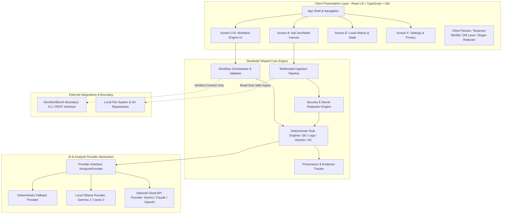
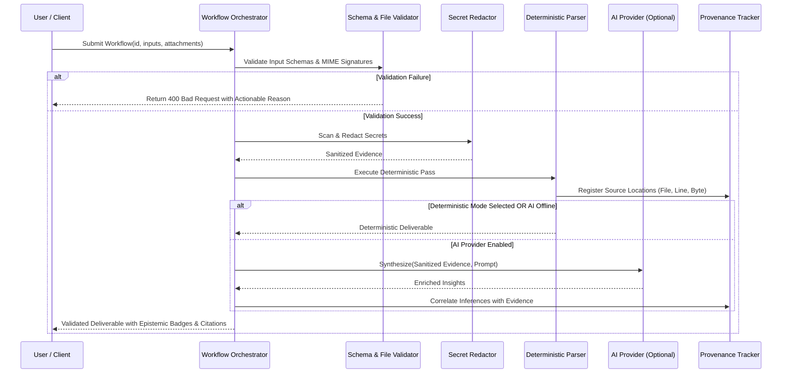

# DevRelief — Technical Architecture

**Product:** DevRelief  
**Document:** System Architecture & Technical Specification  
**Status:** Milestone 0 Foundation  
**Version:** 0.1.0  

---

## 1. System Overview & Architectural Topology

DevRelief follows a modular, local-first topology designed to operate reliably on an engineer's laptop, inside an isolated corporate intranet, or as a self-hosted team server.



---

## 2. Technology Stack & Rationale

| Component | Choice | Rationale |
| :--- | :--- | :--- |
| **Frontend Framework** | **React 19 + TypeScript** | Strict type safety, modular functional hooks, and industry standard for productivity workbenches. |
| **Build & Dev Tooling** | **Vite** | Instant build times, robust ES modules, and lightweight dev footprint. |
| **Styling & Theme** | **Tailwind CSS v4** | Utility-first CSS, minimal bundle footprint, zero runtime styling overhead, perfect for responsive ergonomics. |
| **Iconography** | **Lucide React** | Clean, accessible, consistent visual language. |
| **Animations** | **Motion** | Fluid, accessible layout transitions for drawers, accordions, and bottom sheets. |
| **Backend & API** | **Node.js Express / Python FastAPI** | Express in web-dev container proxy; FastAPI planned for backend service for deep AST/Python data processing. |
| **Data Validation** | **Zod / Pydantic** | Strict schema validation at ingestion boundaries for both UI forms and file extracts. |
| **Local Storage** | **Browser IndexedDB / SQLite** | Local-first persistence. Zero data leaves the machine unless explicitly synced. |

---

## 3. Shared Workflow Engine Architecture

The core of DevRelief is a single, unified execution engine rather than disparate scripts or separate applications. Every workflow follows a standardized lifecycle:



### Key Orchestrator Guarantees
1. **Schema Compliance:** All workflow inputs and outputs conform to strict TypeScript/JSON schemas.
2. **Deterministic Baseline:** The deterministic pass executes *first*. Even if an AI provider fails or times out, the user receives the deterministic baseline results.
3. **Audit Trail & Provenance Registry:** Every finding in the deliverable links back to a byte-range or line-number citation registered in the provenance database.

---

## 4. AI Provider Abstraction Layer

DevRelief decouples business logic from any specific model provider via the `IAnalysisProvider` interface:

```typescript
export interface AnalysisRequest {
  taskId: string;
  userPrompt: string;
  evidencePackage: EvidencePackage;
  options: {
    temperature?: number;
    maxTokens?: number;
    requireVision?: boolean;
    localOnly?: boolean;
  };
}

export interface AnalysisResponse {
  summary: string;
  facts: Array<{ statement: string; provenance: SourceReference }>;
  inferences: Array<{ statement: string; confidence: number; rationale: string }>;
  unknowns: string[];
  suggestedActions: string[];
  providerUsed: 'deterministic' | 'ollama' | 'cloud-gemini' | 'cloud-openai';
}

export interface IAnalysisProvider {
  readonly id: string;
  readonly name: string;
  readonly isLocal: boolean;
  readonly supportsVision: boolean;
  
  checkHealth(): Promise<{ available: boolean; latencyMs: number; error?: string }>;
  synthesize(request: AnalysisRequest): Promise<AnalysisResponse>;
}
```

### Provider Implementations
1. **`DeterministicProvider` (Default):**
   - 100% offline, zero CPU overhead, zero privacy risk.
   - Extracts regex patterns, conventional commit headers, stack-trace error roots, and Gherkin structures.
2. **`OllamaProvider` (Local AI):**
   - Connects to local daemon at `http://localhost:11434`.
   - Discovers installed models (e.g. `gemma2:9b`, `llama3.1:8b`).
   - Automatically detects if the active model supports vision (e.g. `llava`, `llama3.2-vision`) before routing image inputs.
3. **`ExternalCloudProvider` (Opt-in Cloud AI):**
   - Requires explicit user configuration and active opt-in.
   - Transparently displays full payload size and target endpoint prior to transmission.

---

## 5. DevWorkBench Boundary Contract

DevWorkBench is an external engineering tool focusing on automated code remediation and Safe Fix algorithms. DevRelief respects a strict separation:

1. **Non-Invasion:** DevRelief never imports or duplicates DevWorkBench's AST rewriting or automated patch application code.
2. **Integration Vector:** When DevWorkBench is available on the host machine, DevRelief interacts exclusively via its official CLI:
   ```bash
   devworkbench inspect --file <path> --json
   ```
3. **Resilient Degradation:** If DevWorkBench is absent, DevRelief marks the external inspection as "Unavailable on host" and continues rendering standard log/diff analysis.

---

## 6. Hosted vs. Local Processing Disclosure Model

To eliminate deceptive marketing and user uncertainty, DevRelief enforces an **Epistemic Disclosure Standard**:

| Environment | Processing Location | Storage Location | Disclosure UI Badge |
| :--- | :--- | :--- | :--- |
| **Local Desktop App** | Host Machine (Deterministic / Ollama) | Local IndexedDB | 🟢 `Local Only — 100% On-Device` |
| **Self-Hosted Intranet** | Organization On-Prem Server | Private Team DB | 🔵 `Self-Hosted Intranet — Org Boundary` |
| **Cloud Web Applet** | Web Browser & Secure Cloud Worker | Session Memory & Cloud Run | 🟠 `Cloud Web Preview — Transmitted over TLS` |

The UI permanently renders an interactive status chip reflecting the exact current mode.
