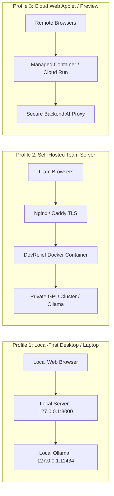

# DevRelief — Deployment & Infrastructure Guide

**Product:** DevRelief  
**Document:** Deployment Topologies & Operational Guide  
**Status:** Milestone 0 Foundation  

---

## 1. Supported Deployment Topologies

DevRelief supports three distinct deployment profiles:



---

## 2. Profile 1: Local-First Desktop / Developer Workstation (Recommended)

This is the primary operating mode for individual engineers, offering maximum privacy and zero network transmission.

### Configuration
- Host binding: `127.0.0.1:3000` (Strictly non-routable loopback).
- Storage: Browser IndexedDB (`devrelief_db_v1`).
- AI Engine: Local Ollama daemon (`http://127.0.0.1:11434`).

### Quick Start
```bash
# Clone the repository
git clone https://github.com/your-org/devrelief.git
cd devrelief

# Install dependencies
npm install

# Start local workbench
npm run dev
# Accessible exclusively at http://127.0.0.1:3000
```

---

## 3. Profile 2: Self-Hosted Team Server (On-Prem / VPC)

For engineering organizations wishing to provide a shared, private DevRelief workbench to their teams with zero public cloud transmission.

### Docker Compose Architecture
```yaml
version: '3.8'

services:
  devrelief-app:
    image: devrelief:latest
    build:
      context: .
      dockerfile: Dockerfile
    restart: unless-stopped
    ports:
      - "127.0.0.1:3000:3000" # Bind to loopback; fronted by Nginx
    environment:
      - NODE_ENV=production
      - OLLAMA_HOST=http://ollama-service:11434
      - ENABLE_DETERMINISTIC_ONLY=false
      - MAX_UPLOAD_SIZE_MB=50
    depends_on:
      - ollama-service

  ollama-service:
    image: ollama/ollama:latest
    restart: unless-stopped
    volumes:
      - ollama_models:/root/.ollama
    deploy:
      resources:
        reservations:
          devices:
            - driver: nvidia
              count: all
              capabilities: [gpu]

volumes:
  ollama_models:
```

---

## 4. Environment Variables & Security Constraints

| Variable Name | Required | Default | Description |
| :--- | :--- | :--- | :--- |
| `NODE_ENV` | Optional | `development` | Deployment environment (`development`, `production`). |
| `PORT` | Optional | `3000` | Port for the web workbench server. |
| `HOST` | Optional | `127.0.0.1` | Network interface to bind. Must remain `127.0.0.1` unless in an isolated VPC. |
| `OLLAMA_HOST` | Optional | `http://127.0.0.1:11434` | Endpoint for local model inference. |
| `MAX_UPLOAD_SIZE_MB` | Optional | `20` | Bounded file size per attachment (hard cap 50). |
| `ENABLE_SECRET_REDACTION` | Optional | `true` | Automated credential sanitizer toggle. |
| `GEMINI_API_KEY` | Optional | *None* | Required only when explicit cloud AI option is enabled. Injected server-side only. |

### Golden Security Rule
Client-side code never accesses or stores master credentials or cloud secrets. All remote API invocations must route through an authenticated server-side proxy (`/api/*`).
