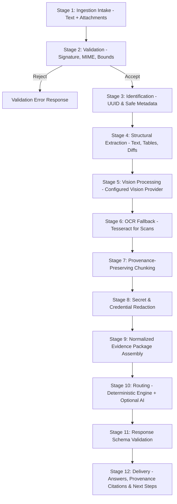

# DevRelief — Multimodal Ingestion Pipeline Specification

**Product:** DevRelief  
**Document:** Multimodal Ingestion Architecture & Data Pipeline  
**Status:** Milestone 0 Foundation  

---

## 1. 12-Stage Ingestion Pipeline

The multimodal ingestion pipeline processes heterogenous engineering artifacts into a verified, sanitized, and attributed **Evidence Package**:



### Detailed Stage Breakdown

1. **Stage 1: Ingestion Intake:** Receives user prompt along with 1 to 10 file streams via drag-and-drop, file picker, clipboard paste, or CLI pipe.
2. **Stage 2: Format & Signature Validation:** Reads the first 512 bytes to verify magic numbers against declared MIME type. Blocks prohibited executable or archive formats.
3. **Stage 3: Identification & Safe Metadata:** Generates a deterministic UUID (`att_uuid_v4`) for each attachment; sanitizes filename (strips path separators, control characters); captures byte size, modified date, and content hash (SHA-256).
4. **Stage 4: Structural Extraction:**
   - Plaintext / Code / Diffs: Line-by-line indexed array.
   - CSV / TSV / XLSX: Structured table schema extraction with column headers and row indices.
   - JSON / YAML: Syntax-validated structured tree.
   - Markdown: Section headers, code fences, and bullet hierarchies.
5. **Stage 5: Vision Processing:**
   - If an active local or configured cloud provider supports vision, images are downscaled if necessary (max dimension 2048px) and fed to the vision encoder.
6. **Stage 6: OCR Fallback:**
   - If no vision model is active or for documents containing embedded raster scans, Tesseract OCR extracts text blocks while preserving pixel coordinates (bounding boxes).
7. **Stage 7: Provenance-Preserving Chunking:**
   - Large text documents are split into overlapping semantic chunks (max 1000 tokens / ~4000 characters with 10% overlap).
   - **Critical:** Every chunk preserves its starting line number, ending line number, and original attachment UUID.
8. **Stage 8: Secret & Credential Redaction:**
   - Regex-based high-speed redaction scans all extracted text for API tokens, passwords, AWS keys, JWTs, and private keys. Replaces them with `[REDACTED_API_KEY]`.
9. **Stage 9: Evidence Package Assembly:**
   - Combines sanitized text, extracted metadata, images, and provenance indices into a strongly typed `EvidencePackage` object.
10. **Stage 10: Dual Routing:**
    - Primary pass: Deterministic rule-based parser extracts confirmed facts.
    - Secondary pass (optional): If AI is configured, sends prompt and evidence package for semantic synthesis.
11. **Stage 11: Output Schema Validation:**
    - Enforces JSON Schema / Pydantic validation on the generated response.
12. **Stage 12: Delivery & Epistemic Attribution:**
    - Renders final UI view with interactive citations, epistemic badges (`Fact`, `Inference`, `Unknown`), and export options.

---

## 2. Evidence Provenance Data Schema

To guarantee that no finding is fabricated, every fact and inference must carry an unbroken provenance chain:

```typescript
export interface SourceLocation {
  attachmentId: string;
  filename: string;
  mimeType: string;
  locationType: 'line_range' | 'byte_offset' | 'table_cell' | 'bounding_box' | 'page_number';
  startLine?: number;
  endLine?: number;
  pageNumber?: number;
  sheetName?: string;
  rowNumber?: number;
  columnName?: string;
  boundingBox?: {
    x: number;
    y: number;
    width: number;
    height: number;
  };
  rawExcerpt: string; // The exact verified verbatim snippet
}

export interface EpistemicFinding {
  id: string;
  category: 'confirmed_fact' | 'inference' | 'unknown';
  statement: string;
  provenance: SourceLocation[];
  confidenceScore: number; // 1.0 for facts; 0.0 - 0.99 for inferences
  rationale?: string;
}

export interface EvidencePackage {
  packageId: string;
  createdAt: string;
  prompt: string;
  attachments: Array<{
    id: string;
    originalName: string;
    sanitizedName: string;
    sizeBytes: number;
    sha256: string;
    extractedTextLength: number;
    warnings: string[];
  }>;
  findings: EpistemicFinding[];
}
```

---

## 3. Large File Handling & Memory Bounding

To prevent browser tab crashes or server Out-Of-Memory (OOM) panics when users drop giant CI logs:

1. **Max Limits:**
   - Single file maximum: **20 MB** (Default), hard ceiling **50 MB**.
   - Total batch upload limit: **50 MB** across all attachments.
   - Max attachment count: **5 files** (Default), maximum **10 files**.
2. **Streaming & Bounded Reading:**
   - Files > 5 MB are read in 64 KB chunks using browser `ReadableStream` or Node `fs.createReadStream`.
3. **Smart Log Windowing (Head & Tail Extraction):**
   - In CI logs exceeding 50,000 lines, failures almost universally occur in the final 3,000 lines, with environmental context in the first 500 lines.
   - DevRelief automatically scans:
     - **Head:** Lines 1 to 500 (Environment, OS, compiler version).
     - **Tail:** Lines $(N-3000)$ to $N$ (Stack traces, test runners, exit codes).
     - **Middle:** Grepped for error signatures (`ERROR`, `FATAL`, `EXCEPTION`, `FAIL`).
   - The user interface explicitly informs the user:  
     *⚠️ Log exceeds 50,000 lines. Retained lines 1–500 and 47,000–50,000 + 4 error clusters. Middle 46,500 lines elided.*

---

## 4. Multi-Attachment Cross-Referencing

When multiple attachments are uploaded (e.g. Screenshot + Log + Config), DevRelief enables cross-referencing:

- **Attachment Identifiers:** In prompt text and output, attachments are referenced via shorthand tags (e.g. `@file1`, `@file2`).
- **Co-occurrence Analysis:** Correlates timestamps between separate log files (e.g. frontend error timestamp `14:22:01` mapped to backend database timeout at `14:22:02`).
- **Partial Extraction Resilience:**
  - If 1 of 3 attachments cannot be read (e.g. corrupted PDF), extraction marks that file with an error badge and proceeds with the remaining 2 files.
  - The UI presents an Amber Partial Extraction banner:  
    *⚠️ Could not extract text from `corrupt_spec.pdf` (Invalid PDF header). Analysis generated using `app.log` and `config.yaml`.*

---

## 5. Format Support Matrix & Explicit Limitations

| Format Category | Extension | Magic Bytes / Signature | Status | Limits & Fallback |
| :--- | :--- | :--- | :--- | :--- |
| **Images** | `.png` | `89 50 4E 47` | Supported | Max 2048x2048px; downscaled automatically. |
| | `.jpg`, `.jpeg` | `FF D8 FF` | Supported | EXIF stripped for privacy. |
| | `.webp` | `52 49 46 46 ... 57 45 42 50` | Supported | Single frame only (animated WebP rejected). |
| **Text & Logs** | `.txt`, `.log` | Plain UTF-8 / ASCII | Supported | Tail windowing above 10MB. |
| | `.json`, `.jsonl` | Valid JSON root or newline JSON | Supported | JSON syntax validated; unparsable lines reported. |
| | `.yaml`, `.yml` | YAML header / mapping | Supported | Safe YAML loader (no object instantiation). |
| | `.xml` | `<?xml` or tag root | Supported | DTD & external entity expansion disabled (XXE defense). |
| | `.csv`, `.tsv` | Delimited text | Supported | Converted to bounded tabular array (max 5000 rows). |
| | `.md` | Markdown text | Supported | Full structural header/fence parsing. |
| **Documents** | `.pdf` | `%PDF-` | Supported | Text layer extracted. If scanned, Tesseract applied. Max 50 pages. |
| | `.docx` | `PK 03 04` (ZIP/OfficeOpen) | Supported | XML body extracted; macros and embedded scripts rejected. |
| | `.xlsx` | `PK 03 04` (ZIP/OfficeOpen) | Supported | First 3 sheets extracted; formulas converted to calculated values. |
| | `.pptx` | `PK 03 04` (ZIP/OfficeOpen) | Planned (M2) | Slide notes and text shapes extracted. |
| **Engineering** | `.diff`, `.patch` | Unified diff header (`---`/`+++`) | Supported | Parsed into files, hunks, additions, deletions. |
| | Code (`.ts`, `.py`, etc.) | UTF-8 code text | Supported | Syntax tokenized; never executed or evaluated. |
| **Blocked** | `.exe`, `.dll`, `.so` | `MZ`, `ELF` | **BLOCKED** | Explicit rejection with security warning. |
| | `.sh`, `.bat`, `.cmd` | Shell scripts | **BLOCKED** | Prohibited from ingestion to prevent accidental execution. |
| | `.zip`, `.tar`, `.gz` | Archives | **BLOCKED** | Prohibited to prevent decompression bombs. |
