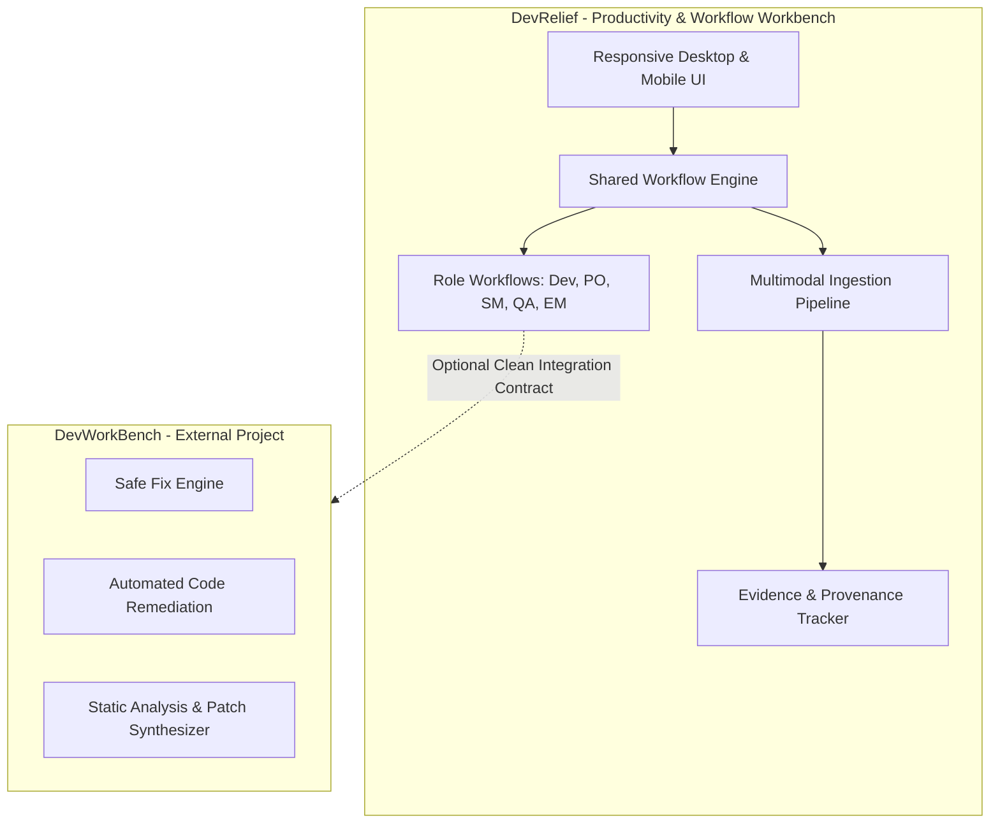

# DevRelief — Product Specification

**Product:** DevRelief  
**Tagline:** *Make work feel lighter.*  
**Status:** Milestone 0 (Specification & Architecture Foundation)  
**Version:** 0.1.0  
**Authors:** DevRelief Architecture & Product Engineering  

---

## 1. Executive Summary & Vision

Modern software delivery teams lose between 25% and 40% of their productive time to repetitive friction: transcribing whiteboard notes into tickets, hunting through 10,000-line CI logs for the first real compiler error, formatting release notes across multiple pull requests, reconciling conflicting sprint metrics, and manually reformatting technical artifacts.

**DevRelief** is a web-first, local-first productivity workbench designed to eliminate this friction. Rather than being another conversational chatbot that hallucinates ungrounded advice or demands an expensive cloud AI subscription, DevRelief functions as a structured workspace. Users describe tasks, attach relevant evidence (logs, screenshots, Git diffs, test reports, requirements documents), ask cross-modal questions, and receive structured, verifiable, reviewable deliverables.

### Core Philosophy
1. **Local-First Processing:** Processing takes place locally by default. No data leaves the user's workstation or self-hosted boundary without explicit consent.
2. **Deterministic-First Core:** Core parsing, log scanning, diff analysis, table extraction, and templating workflows operate reliably with zero AI dependencies.
3. **Optional Local AI:** Local open models (via Ollama or compatible runtimes) provide intelligent synthesis when enabled, with zero reliance on proprietary cloud APIs.
4. **No Silent Uploads:** Processing location (Local deterministic / Local Ollama / Explicit Cloud) is permanently disclosed in the user interface.
5. **Rigorous Evidence Provenance:** Answers cite source attachments with file paths, line ranges, timestamps, and page numbers. Unsubstantiated claims are strictly prohibited.
6. **Explicit Epistemic Grading:** All generated analysis explicitly labels findings as **Confirmed Fact**, **Inference / Deduction**, or **Unknown / Unverified**.
7. **Human in the Loop:** DevRelief never automatically executes commands, pushes code, or modifies external systems. All generated scripts or CLI instructions require manual user review and approval.
8. **Universal Role Support on a Single Engine:** One shared workflow engine powers role-tailored workspaces for the entire delivery team.

---

## 2. Product Boundaries & The DevWorkBench Interface

DevRelief maintains a strict architectural boundary with respect to **DevWorkBench** (and similar code-repair tools):



### Architectural Boundary Rules
1. **No Duplication:** DevRelief does not re-implement Safe Fix algorithms, automated AST patch generation, or deep automated compiler repair loops.
2. **Focus Area:** DevRelief focuses on communication, evidence ingestion, multi-artifact synthesis, cross-role coordination, and structured deliverable authoring.
3. **Optional Coupling:** DevRelief remains 100% operational when DevWorkBench is not present or configured.
4. **Integration Protocol:** Any future interaction with DevWorkBench must:
   - Target an existing, verified CLI or REST/gRPC API.
   - Require explicit user configuration and consent.
   - Gracefully handle missing binaries, incompatible versions, or network timeouts.
   - Treat DevWorkBench outputs as external untrusted evidence subject to standard ingestion checks.

---

## 3. Target Audiences & Primary Needs

DevRelief delivers a cohesive experience tailored to five primary delivery roles:

| Audience | Primary Frustrations | DevRelief Solution |
| :--- | :--- | :--- |
| **Software Developers** | Context switching, crafting daily standup notes from fragmented Git branches, debugging cryptic CI failures across multiple attachments, writing release notes. | Automated Git digest from commit trees, screenshot-plus-log CI failure root-cause extraction, automated release note drafting from diffs. |
| **Product Owners** | Ambiguous business requirements, formatting user stories and acceptance criteria from unstructured discovery notes or meeting transcripts. | Note-to-story transformer, automated Gherkin AC synthesis, requirements ambiguity scanner with targeted clarification queries. |
| **Scrum Masters** | Manually compiling sprint review decks, transcribing retrospective notes into actionable tracker items, identifying stale blockers across board screenshots. | Meeting-to-action-item extractor, sprint review summarizer, cross-team blocker and dependency matrix. |
| **QA Engineers** | Converting verbal specs into test matrices, transcribing error screenshots into reproducible bug tickets, verifying AC coverage against test suites. | Spec-to-scenario generator, failure screenshot and trace to repro step converter, automated test gap analysis. |
| **Engineering Managers / Leads** | Gathering delivery status across multiple repositories and boards, compiling executive updates, orchestrating cross-team handovers. | Evidence-backed status synthesizers, blocker trend reports, standardized onboarding and technical handover briefings. |

---

## 4. Multimodal "Ask DevRelief" Experience

The unified "Ask DevRelief" workspace is the central multi-artifact problem-solving canvas. Users pose natural-language questions accompanied by one or more heterogenous attachments.

### Example Scenario
> **User Prompt:** "Why is this Jenkins pipeline failing? Compare the screenshot of the console with the attached raw build log and maven POM, identify the first meaningful failure, explain the likely cause, and suggest the next diagnostic steps."  
> **Attachments:** `screenshot_pipeline_fail.png`, `build_output.log`, `pom.xml`.  
> **DevRelief Output:**
> 1. **Executive Verdict:** Build failure triggered by circular dependency in Maven module `auth-service` (first occurrence at `build_output.log:1482`).
> 2. **Cross-Referenced Evidence:**
>    - `build_output.log:1482-1490` indicates `[FATAL] Non-resolvable parent POM for com.acme:auth-service:0.4.1`.
>    - `pom.xml:18` shows version declared as `0.4.2-SNAPSHOT`, conflicting with parent repository reference.
>    - `screenshot_pipeline_fail.png:Region(top-right)` confirms step `mvn verify` exited with code 1.
> 3. **Epistemic Classification:**
>    - **Confirmed Fact:** Version mismatch exists between parent reference and child POM.
>    - **Inference:** Parent POM artifact `0.4.1` was purged from local Nexus mirror during nightly maintenance.
>    - **Unknown:** Whether branch `feature/auth-refresh` was meant to re-point to parent `0.4.2-SNAPSHOT`.
> 4. **Diagnostic Recommendations:** Review parent POM version declaration; run `mvn dependency:tree` locally.

### Planned Input Format Matrix

| Category | Extensions | Processing Level | Fallback Mechanism | Unsupported Aspects |
| :--- | :--- | :--- | :--- | :--- |
| **Images** | `.png`, `.jpg`, `.jpeg`, `.webp` | Vision Model / OCR | Tesseract OCR + Metadata extraction | Animated GIFs, SVG scripting, RAW image formats. |
| **Text & Logs** | `.txt`, `.log`, `.json`, `.jsonl`, `.yaml`, `.yml`, `.xml`, `.csv`, `.md` | Deterministic Tokenizer & Log Parser | Head/Tail regex scanner with bounded chunking | Executable scripts (`.sh`, `.bat`), files exceeding 50 MB (subject to bounded tail scanning). |
| **Documents** | `.pdf`, `.docx`, `.xlsx`, `.pptx` | Deterministic Structural Extractor | Plaintext / Markdown table converter | Embedded macros, encrypted/password-protected documents, DRM-protected PDFs. |
| **Engineering Artifacts** | `.diff`, `.patch`, source snippets (`.ts`, `.py`, `.go`, etc.) | Deterministic Diff & Syntax Parser | Universal Unified Diff Lexer | Binary compiled diffs, proprietary profiling dumps. |

---

## 5. Role-Specific Workflow Specifications

Every workflow in DevRelief is governed by a strict schema, deterministic fallback behavior, evidence requirements, and acceptance criteria.

### 5.1 Developer Workflows

#### WF-DEV-01: Git Activity Daily Digest
- **Target User:** Software Developers, Team Leads.
- **Inputs:** Local Git commit log (`git log --since="yesterday"` or patch file), active branch names.
- **Optional Inputs:** Standup notes or ticket references.
- **Supported Attachments:** `.patch`, `.diff`, `.txt`, `.log`.
- **Output Schema:**
  ```json
  {
    "summary": "string",
    "completed_work": [{"category": "string", "description": "string", "commits": ["string"]}],
    "in_progress": [{"branch": "string", "current_focus": "string"}],
    "potential_blockers": ["string"],
    "evidence_provenance": [{"source": "string", "reference": "string"}]
  }
  ```
- **Deterministic vs AI:** Deterministic parser groups commits by author, conventional commit tags (feat, fix, refactor), and Jira keys. Optional AI enriches semantic summaries.
- **Fallback:** If AI unavailable, produces grouped Markdown list directly from conventional commit headers.
- **Acceptance Criteria:** Must parse standard `git log` output; must group items by conventional commit prefix; must isolate PR references.

#### WF-DEV-02: Change Summaries & Release Note Drafts
- **Target User:** Developers, Tech Leads, Release Engineers.
- **Inputs:** Unified diff or list of merged pull requests, version tag string.
- **Output Schema:** Categorized release notes (Features, Bug Fixes, Breaking Changes, Dependency Updates) with commit and author attribution.
- **Deterministic vs AI:** AST/diff parser extracts changed packages and commit subjects deterministically; AI writes user-facing prose summaries.

#### WF-DEV-03: Technical Handover Briefing
- **Target User:** Senior Developers rotating off projects, On-call Engineers.
- **Inputs:** Architecture notes, repository structure overview, recent deployment history.
- **Output Schema:** System overview, critical operational runbooks, top failure modes, contact points, open technical debts.

---

### 5.2 Product Owner Workflows

#### WF-PO-01: Rough Notes to User Stories & Gherkin AC
- **Target User:** Product Owners, Business Analysts.
- **Inputs:** Meeting transcript, discovery bullet points, or customer conversation notes.
- **Output Schema:** Standard story format (`As a... I want to... So that...`) with Gherkin acceptance criteria (`Given... When... Then...`).
- **Deterministic vs AI:** Keyword extractor isolates personas and business goals; AI structures scenarios. Fallback produces structured checklist from bullet items.

#### WF-PO-02: Requirements Ambiguity Scanner
- **Target User:** Product Owners, System Architects.
- **Inputs:** Feature specification document (`.md`, `.docx`, `.pdf`, or text).
- **Output Schema:** Ambiguity severity rating (High/Medium/Low), highlighted ambiguous terms ("as fast as possible", "user-friendly", "periodically"), missing edge cases, and targeted clarification questions.
- **Deterministic vs AI:** Regex-based heuristic lexicon flags vague quantifiers; AI synthesizes domain-specific edge cases.

---

### 5.3 Scrum Master Workflows

#### WF-SM-01: Meeting Notes to Action Item Matrix
- **Target User:** Scrum Masters, Project Coordinators.
- **Inputs:** Raw meeting transcript or retro notes.
- **Output Schema:** Action item table: Task description, assigned owner (or UNASSIGNED), deadline/target sprint, priority, source line citation.
- **Deterministic vs AI:** Sentence heuristic detects modal verbs ("will", "must", "agreed to", "@name"); AI refines concise task statements.

#### WF-SM-02: Sprint Retrospective Synthesis
- **Target User:** Scrum Masters, Agile Coaches.
- **Inputs:** Retrospective board export (What went well, What didn't, Ideas).
- **Output Schema:** Thematic clustering, sentiment overview, top three actionable experiments for the next sprint.

---

### 5.4 QA Engineer Workflows

#### WF-QA-01: Specification to Draft Test Scenarios
- **Target User:** QA Engineers, Test Automators.
- **Inputs:** User story text, API specification, or acceptance criteria.
- **Output Schema:** Test matrix containing: Happy path test cases, negative boundary scenarios, security/permissions test cases, idempotency checks.
- **Deterministic vs AI:** Deterministic matrix generator ensures all Gherkin "Given/When/Then" nodes receive corresponding positive and negative test cases.

#### WF-QA-02: Error Screenshot & Trace to Repro Ticket
- **Target User:** QA Engineers, Support Engineers.
- **Inputs:** UI screenshot with error dialog, browser console log, network HAR extract.
- **Output Schema:** Standard Bug Report: Environment, Preconditions, Exact Steps to Reproduce, Expected Behavior, Actual Behavior, Relevant Logs snippet.

---

### 5.5 Engineering Manager Workflows

#### WF-EM-01: Delivery Summary from Multi-Source Evidence
- **Target User:** Engineering Managers, Directors.
- **Inputs:** Git activity summary, test run report, release checklist.
- **Output Schema:** High-level status dashboard: Milestone progress percentage, major deliverables completed, open critical defects, risks and dependencies.
- **Honest Limitations Disclosure:** If issue trackers or board states are not connected, the summary explicitly warns: "Derived solely from provided Git and Test logs; does not reflect external ticket statuses."

---

## 6. General Non-Functional & Quality Attributes

1. **Performance:** UI first contentful paint < 1.0s; deterministic file ingestion and validation < 300ms for files < 10MB; responsive interaction under 60fps animations.
2. **Resilience:** Graceful partial degradation. If 3 of 4 files parse successfully, analysis continues on the 3 files with an explicit warning banner on the failed file.
3. **Accessibility:** Target WCAG 2.2 AA compliance: visible focus rings, full keyboard accessibility, minimum 4.5:1 text contrast, ARIA landmarks and live regions.
4. **Zero-Pill UI Discipline:** Clean, purposeful layout without decorative clutter, synthetic AI badges, or distracting animated gradients.
