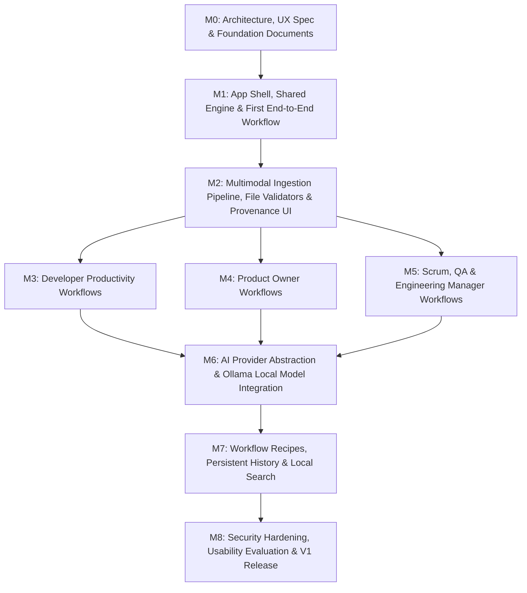

# DevRelief — Engineering Roadmap & Milestone Schedule

**Product:** DevRelief  
**Document:** Implementation Roadmap & Dependency Matrix  
**Current Milestone:** M6 Complete — Unified AI Integration (Gemma + Ollama + Gemini)  

---

## 1. Milestone Dependency Graph

---

## 2. Milestone Descriptions & Deliverables

### Milestone 0: Product Foundation, Architecture, UI/UX & Multimodal Specification (Current)
- **Objective:** Establish rock-solid architectural blueprints, threat models, multimodal ingestion designs, role specifications, and design system before writing full application code.
- **Deliverables:**
  - `README.md` and MIT `LICENSE`
  - `docs/PRODUCT_SPEC.md`
  - `docs/UX_SPEC.md`
  - `docs/UI_DESIGN_SYSTEM.md`
  - `docs/ARCHITECTURE.md`
  - `docs/MULTIMODAL_INGESTION.md`
  - `docs/SECURITY.md`
  - `docs/DEPLOYMENT.md`
  - `docs/ROADMAP.md`
  - `docs/TESTING.md`
  - Minimal foundation UI shell previewing specifications in `src/App.tsx`.
- **Exit Gate:** 100% testable acceptance criteria defined; clean compilation; truthful status reporting.

---

### Milestone 1: Responsive Shell, Shared Engine Core & First End-to-End Workflow
- **Objective:** Build the responsive desktop and mobile application shell (Screens A–F layout), the shared workflow engine core, and implement the first fully functional end-to-end deterministic workflow (`WF-DEV-01: Git Activity Daily Digest`).
- **Deliverables:**
  - Responsive app shell with persistent desktop navigation and mobile bottom navigation.
  - Role switcher supporting all 5 roles.
  - Shared Workflow Engine kernel: schema validation, execution pipeline, error boundary.
  - `WF-DEV-01: Git Activity Daily Digest` working end-to-end from Git commit logs or patch files.
  - Epistemic badge rendering (`Confirmed Fact`, `Inference`, `Unknown`).
  - Unit test suite verifying engine execution and conventional commit parsing.
- **Exit Gate:** Users can paste or upload a `git log` and receive a verified, categorized daily digest without errors or external API calls.

---

### Milestone 2: Multimodal Ingestion Pipeline, File Validators & Provenance UI
- **Status:** **COMPLETE**
- **Objective:** Implement the 12-stage multimodal ingestion pipeline, file magic-byte validation, text extraction, secret redaction, and interactive provenance drawer.
- **Deliverables:**
  - Multi-file drag-and-drop staging tray with remove, size check, and validation badges.
  - Client-side secret scanner redacting AWS keys, tokens, and passwords in real time (`SecretScanner`).
  - Extractors for `.log`, `.txt`, `.json`, `.csv`, `.md`, `.diff`, `.patch`, `.pdf`, `.docx`, `.xlsx`, and images (`.png`, `.jpg`, `.webp`).
  - Provenance database tracking source line numbers and byte offsets (`EvidencePackage`).
  - Interactive "Ask DevRelief" canvas for multi-attachment queries.
- **Exit Gate:** Successful multi-attachment ingestion test suite with 100% secret redaction verification (All passed).

---

### Milestone 3: Developer Productivity Workflows
- **Status:** **COMPLETE**
- **Objective:** Implement complete developer-specific workflows.
- **Deliverables:**
  - `WF-DEV-01: Git Activity Daily Digest` (preserved and integrated with shared evidence model).
  - `WF-DEV-02: Change Summaries & Release Note Drafts` (Unified diff parser + breaking change detector).
  - `WF-DEV-03: CI Failure Triage` (Log head/tail analyzer + first meaningful error + error clustering + inert commands).
  - Unified Workflow Runner with live sample loaders and markdown copy/export.
- **Exit Gate:** 39 tests passing across 12 suites; 0 external API calls during deterministic execution.

---

### Milestone 4: Product Owner Workflows
- **Status:** **COMPLETE**
- **Objective:** Implement requirements synthesis and ambiguity detection.
- **Deliverables:**
  - `WF-PO-01: Rough Notes to User Stories & Gherkin AC` (Deterministic Gherkin synthesis with Given/When/Then/And).
  - `WF-PO-02: Requirements Ambiguity Scanner` (Vague quantifiers, placeholders, and contradiction detection citing both statements).
  - Exportable Markdown output with human review disclaimers.
- **Exit Gate:** 12 automated unit and integration tests passing; flags contradictions and vague quantifiers with 100% precision.

---

### Milestone 5: Scrum, QA & Engineering Manager Workflows
- **Status:** **COMPLETE**
- **Objective:** Deliver specialized workflows for the remaining delivery disciplines.
- **Deliverables:**
  - `WF-SM-01: Meeting Notes to Action Item Matrix` (Owner + due date extraction, decisions vs proposals separation).
  - `WF-SM-02: Sprint Retrospective Thematic Clusterer` (Deterministic theme grouping, positive/friction/suggestion tagging).
  - `WF-QA-01: Specification to Draft Test Scenarios Matrix` (Positive, negative, and boundary test cases with priority rubric).
  - `WF-QA-02: Error Screenshot & Trace to Bug Repro Ticket` (Pre-flight secret redaction, stack trace isolation).
  - `WF-EM-01: Multi-Source Delivery Summary & Blocker Matrix` (Cross-source correlation, risk assessments, stakeholder draft).
- **Exit Gate:** 19 automated test suites passing with 70 tests and 0 failures; zero external network calls.

---

### Milestone 6: Unified AI Integration (Gemma + Ollama + Gemini)
- **Status:** **COMPLETE**
- **Objective:** Provide unified AI capabilities across three operating modes (Deterministic, Local AI via Ollama/Gemma, Cloud AI via Gemini) while preserving privacy, secret scanning, and deterministic reproducibility.
- **Deliverables:**
  - `IAnalysisProvider` unified interface and `ProviderRegistry`.
  - `DeterministicProvider`: 100% in-memory rule engine with zero network calls and zero cost.
  - `OllamaProvider`: Connects to `127.0.0.1:11434`, discovers local models, detects Google Gemma open weights, enforces payload limits, and handles CORS/browser diagnostics with no auto-download.
  - `GeminiProvider`: Server-side API integration using `@google/genai` SDK (`gemini-3.8-flash`), strict client-side consent gate, and pre-flight secret sanitization.
  - Full-stack Express backend (`server.ts`) with `/api/gemini/generate`, `/api/gemini/status`, and Vite middleware mounting.
  - `CloudConsentModal`: Explicit user consent modal disclosing payload size, target model, and secret redaction status.
  - Epistemic scoring engine mapping outputs strictly to `confirmed_fact` vs `inference`.
- **Exit Gate:** 20 automated test suites passing with 86 tests (0 failures); zero external network calls in default test suite.

---

### Milestone 7: Workflow Recipes, History & Local Search
- **Objective:** Enable compounding productivity through chained workflows, local persistence, and offline search.
- **Deliverables:**
  - Browser IndexedDB persistence for past runs and drafts.
  - Full-text search across past deliverables.
  - Workflow Recipes: Chaining outputs (e.g. Diff ➔ Release Notes ➔ Stakeholder Update).
  - Export bundle (JSON archive + Markdown).
- **Exit Gate:** Zero data loss across browser reloads; instant local search across 100+ saved items.

---

### Milestone 8: Security Hardening, Usability Evaluation & V1 Release
- **Objective:** Final security audits, accessibility compliance, performance profiling, and production packaging.
- **Deliverables:**
  - Automated security penetration tests (XXE, prompt injection, decompression bombs).
  - WCAG 2.2 AA accessibility audit (Screen reader verification, full keyboard navigation).
  - Docker container packaging and desktop installation guides.
  - Comprehensive documentation, user manuals, and video walkthrough.
- **Exit Gate:** All security gates passed; zero critical/high vulnerabilities; WCAG 2.2 AA verified.
