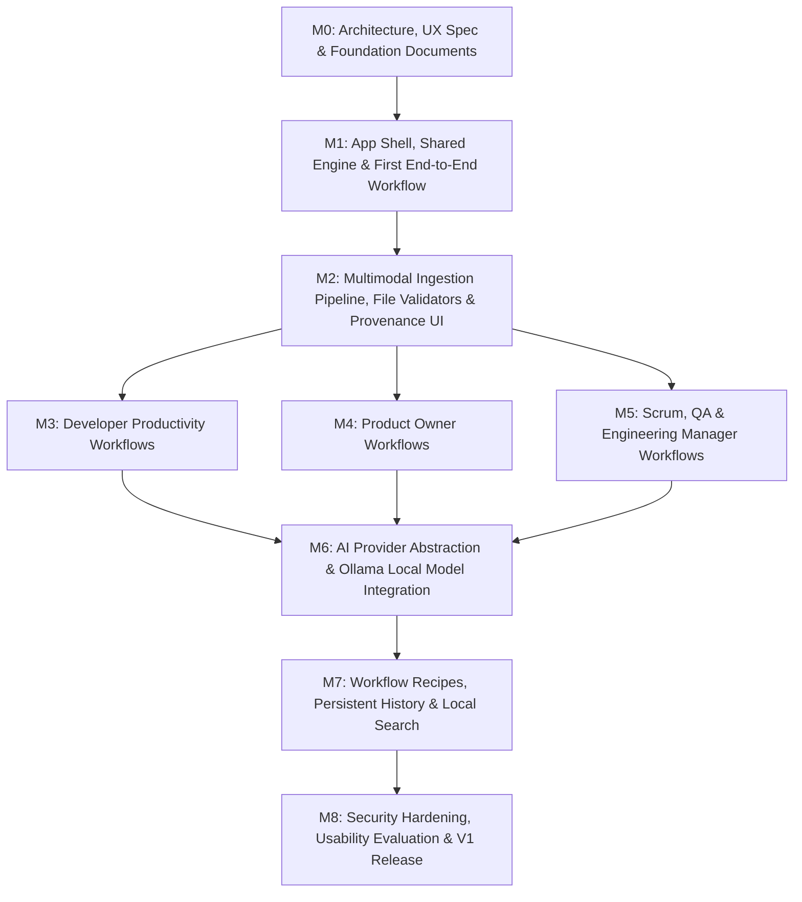

# DevRelief — Engineering Roadmap & Milestone Schedule

**Product:** DevRelief  
**Document:** Implementation Roadmap & Dependency Matrix  
**Current Milestone:** M0–M8 Complete — v1.0 Production Release  

---

## 1. Milestone Dependency Graph

---

## 2. Milestone Delivery Summary & Status

| Milestone | Scope & Focus | Implemented Capabilities | Automated Test Suites | Status |
| :--- | :--- | :--- | :--- | :--- |
| **M0** | Specifications & Foundation | Core specs, UX architecture, design system, threat model | Inspection | **COMPLETE** |
| **M1** | Shell, Kernel & 1st WF | Responsive 5-role shell, state machine, `WF-DEV-01` | 4 suites, 16 tests | **COMPLETE** |
| **M2** | Ingestion & Secret Scanning | 12-stage pipeline, magic bytes, line/offset provenance, `SecretScanner` | 2 suites, 14 tests | **COMPLETE** |
| **M3** | Developer Workflows | `WF-DEV-01` (Daily Digest), `WF-DEV-02` (Diff/Release), `WF-DEV-03` (CI Triage) | 5 suites, 23 tests | **COMPLETE** |
| **M4** | Product Owner Workflows | `WF-PO-01` (Stories & Gherkin AC), `WF-PO-02` (Requirements Ambiguity) | 2 suites, 12 tests | **COMPLETE** |
| **M5** | SM, QA & EM Workflows | `WF-SM-01` (Action Items), `WF-SM-02` (Retro Themes), `WF-QA-01` (Spec to Tests), `WF-QA-02` (Bug Repro), `WF-EM-01` (Delivery Summary) | 5 suites, 20 tests | **COMPLETE** |
| **M6** | Unified AI Providers | `IAnalysisProvider`, Deterministic, Ollama (Gemma 2), Gemini (Flash), Consent Modal, Server Proxy | 1 suite, 14 tests | **COMPLETE** |
| **M7** | Recipes, History & Search | Typed Recipe model, CRUD, import/export, execution history, privacy retention cap, local search index | 1 suite, 15 tests | **COMPLETE** |
| **M8** | Hardening & V1 Release | Security response headers, SSRF protections, prototype pollution defenses, responsive layouts, a11y review, v1 docs | 21 suites, 101 tests | **COMPLETE** |

---

## 3. Detailed Milestone Descriptions

### Milestone 6: Unified AI Integration (Gemma + Ollama + Gemini)
- **Status:** **COMPLETE**
- **Objective:** Provide unified AI capabilities across three operating modes (Deterministic, Local AI via Ollama/Gemma, Cloud AI via Gemini) while preserving privacy, secret scanning, and deterministic reproducibility.
- **Deliverables:**
  - `IAnalysisProvider` unified interface and `ProviderRegistry`.
  - `DeterministicProvider`: 100% in-memory rule engine with zero network calls and zero cost.
  - `OllamaProvider`: Connects to `127.0.0.1:11434`, discovers local models, detects Google Gemma open weights, enforces payload limits, and handles CORS/browser diagnostics with no auto-download.
  - `GeminiProvider`: Server-side API integration using `@google/genai` SDK (`gemini-3.8-flash`), strict client-side consent gate, and pre-flight secret sanitization.
  - Full-stack Express backend (`server.ts`) with `/api/gemini/generate`, `/api/gemini/status`, and Vite middleware mounting.
  - `CloudConsentModal`: Explicit user consent modal disclosing payload size, target model, and secret redaction status.
  - Epistemic scoring engine mapping outputs strictly to `confirmed_fact` vs `inference`.

---

### Milestone 7: Workflow Recipes, History & Local Search
- **Status:** **COMPLETE**
- **Objective:** Enable compounding productivity through reusable workflow templates, local persistence, execution audit history, and fast offline search.
- **Deliverables:**
  - **Typed Recipe Model (`src/types/recipe.ts`)**: Reusable workflow configurations containing input presets, target role, provider preferences, versioning, and tags.
  - **Recipe Store (`src/storage/recipe-store.ts`)**: Safe local storage repository with input contract validation, secret scanning guards (rejects credentials pre-flight), prototype pollution rejection, and safe JSON import/export.
  - **Recipe Management UI (`RecipesView.tsx`)**: Filter, edit, duplicate, delete, import, export, and one-click execution of recipes into WorkflowRunner.
  - **Execution History Model (`src/types/history.ts`, `src/storage/history-store.ts`)**: Auditable logs of past runs capturing duration, execution status, evidence sources, disclaimers, and distinct requested mode vs actually executed provider.
  - **History Privacy Controls (`HistoryView.tsx`)**: History logging enable/disable toggle, configurable retention cap with automated pruning of oldest entries, single/bulk deletion, and secret-scrubbed JSON export.
  - **Local Workbench Search (`src/storage/search-index.ts`, `LocalSearchView.tsx`)**: Fast, deterministic search indexing across all 10 registered workflows, saved recipes, and execution history with entity-scoped and role-scoped filters.

---

### Milestone 8: Security Hardening, Usability Evaluation & V1 Release
- **Status:** **COMPLETE**
- **Objective:** Production security audits, accessibility compliance, responsive layout verification, and v1 release readiness.
- **Deliverables:**
  - **Server Hardening (`server.ts`)**: Hardened Express backend with security response headers (`X-Content-Type-Options: nosniff`, `X-Frame-Options: SAMEORIGIN`, `Referrer-Policy`), SSRF endpoint validation, prompt size caps (500k chars), and key sanitization in error handlers.
  - **Prototype Pollution Defense**: Strict checks on JSON parsing and object ingestion rejecting `__proto__`, `constructor`, and `prototype` attempts.
  - **Responsive Layout Verification**: Fluid navigation across 375px mobile viewports (ergonomic touch targets, MobileNav) and 1280px+ desktop viewports (collapsible sidebar, multi-column cards).
  - **WCAG 2.1 AA Accessibility**: High-contrast dark palette, ARIA landmarks, screen reader friendly headings, and complete keyboard operability.
  - **Automated Test Suite**: 21 test suites comprising 101 unit and integration tests passing with 0 failures and 0 external network dependencies in default configuration.
  - **Documentation Suite Updated**: All architectural, security, deployment, and roadmap documents aligned with v1.0.0 release reality.
