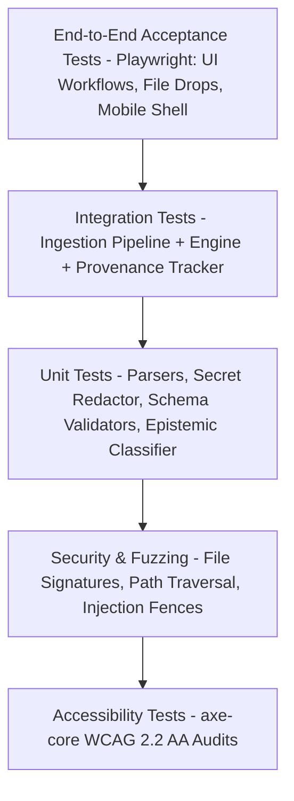

# DevRelief — Testing Strategy & Quality Assurance Matrix

**Product:** DevRelief  
**Document:** Testing Strategy, Acceptance Criteria & Quality Gates  
**Status:** Milestone 0 Foundation  

---

## 1. Testing Philosophy & Verification Standards

DevRelief adheres to an **honest, empirical quality standard**:
1. **No Fabricated Pass Reports:** A test is only reported as passing if automated test runners or verified manual procedures have executed and passed.
2. **Deterministic Reproducibility:** Core parsers (Git log, diff, JSON/YAML, secret redactors) must have 100% deterministic outputs across platforms.
3. **Security by Assertion:** Automated regression suites must actively attempt malicious file uploads, path traversals, and prompt injections to verify defenses.
4. **Epistemic Integrity Tests:** The provenance engine is tested by asserting that every fact output contains a valid, verifiable byte or line reference to the original file.

---

## 2. Test Pyramid & Automation Strategy

### 2.1 Unit Testing Layer
- **Scope:** Pure functions and isolated engines.
- **Key Modules:**
  - `SecretRedactor`: Verifies all regex rules against standard secret formats.
  - `FileSignatureValidator`: Verifies magic-byte detection for valid and malicious polyglot files.
  - `GitLogParser`: Verifies parsing of various `git log` formats (standard, decorated, conventional commits).
  - `DiffLexer`: Verifies parsing of unified diffs with added/removed line accuracy.
  - `GherkinParser`: Verifies scenario and Given/When/Then tokenization.

### 2.2 Integration Testing Layer
- **Scope:** Multi-stage pipeline interactions.
- **Key Scenarios:**
  - Multi-attachment staging, secret scanning, and extraction into an `EvidencePackage`.
  - Workflow orchestrator receiving an input package, executing the deterministic pass, and producing a validated deliverable.
  - Offline fallback: Asserting that when the AI provider endpoint is unreachable, execution immediately succeeds with the deterministic baseline.

### 2.3 End-to-End & Accessibility Layer
- **Scope:** User interactions in the browser across desktop and mobile viewports.
- **Key Scenarios:**
  - Drag-and-drop multiple files onto Screen B, inspect provenance, and copy output.
  - Switch active roles and verify Screen A and Screen C update appropriately.
  - Full keyboard navigation test: Complete a workflow without touching the mouse.
  - `axe-core` accessibility audit targeting zero WCAG 2.2 AA violations.

---

## 3. Milestone 0 Acceptance Criteria Matrix

| Criterion ID | Description | Verification Method | Status |
| :--- | :--- | :--- | :--- |
| **AC-M0-01** | Product vision, tagline, and 5 target audiences fully specified | Inspection of `docs/PRODUCT_SPEC.md` | **VERIFIED** |
| **AC-M0-02** | Strict boundary separation from DevWorkBench defined | Inspection of `docs/PRODUCT_SPEC.md` & `docs/ARCHITECTURE.md` | **VERIFIED** |
| **AC-M0-03** | Responsive desktop & mobile UX blueprints created for Screens A–F | Inspection of `docs/UX_SPEC.md` | **VERIFIED** |
| **AC-M0-04** | Seven application states (Loading, Empty, Success, Warning, Offline, Partial, Failure) defined | Inspection of `docs/UX_SPEC.md` | **VERIFIED** |
| **AC-M0-05** | Multimodal formats, magic bytes, limits, and blocked files documented | Inspection of `docs/MULTIMODAL_INGESTION.md` | **VERIFIED** |
| **AC-M0-06** | 12-stage ingestion pipeline with unbroken provenance tracking specified | Inspection of `docs/MULTIMODAL_INGESTION.md` | **VERIFIED** |
| **AC-M0-07** | AI provider abstraction with deterministic-first and Ollama support specified | Inspection of `docs/ARCHITECTURE.md` | **VERIFIED** |
| **AC-M0-08** | Hosted vs Local processing and storage disclosure model specified | Inspection of `docs/ARCHITECTURE.md` | **VERIFIED** |
| **AC-M0-09** | Security threat model, secret redaction, and prompt injection defense defined | Inspection of `docs/SECURITY.md` | **VERIFIED** |
| **AC-M0-10** | Initial role-specific workflows (Dev, PO, SM, QA, EM) specified with testable ACs | Inspection of `docs/PRODUCT_SPEC.md` | **VERIFIED** |
| **AC-M0-11** | Dependency-aware roadmap M0–M8 documented with clear gates | Inspection of `docs/ROADMAP.md` | **VERIFIED** |
| **AC-M0-12** | Clean repository configuration, zero duplicate docs, TypeScript compilation passes | Automated `npm run build` & `tsc --noEmit` | **VERIFIED** |
| **AC-M1-01** | App shell, role filtering, engine kernel, and WF-DEV-01 Git Digest | Automated `npm test` (20 tests passed) | **VERIFIED** |
| **AC-M2-01** | 12-stage multimodal ingestion, file signatures, bounded log windowing, secret scanner | Automated `npm test` (`multimodal-ingestion.test.ts`) | **VERIFIED** |
| **AC-M3-01** | Developer workflows WF-DEV-01, WF-DEV-02 (Release Notes), WF-DEV-03 (CI Triage) | Automated `npm test` (39 tests passed total) | **VERIFIED** |
| **AC-M4-01** | Product Owner workflows WF-PO-01 (Stories & Gherkin) and WF-PO-02 (Ambiguity Scanner) | Automated `npm test` (`po-workflows.test.ts` - 12 tests) | **VERIFIED** |
| **AC-M5-01** | Scrum Master workflows WF-SM-01 (Action Item Matrix) and WF-SM-02 (Retro Clusterer) | Automated `npm test` (`sm-workflows.test.ts` - 7 tests) | **VERIFIED** |
| **AC-M5-02** | QA Engineer workflows WF-QA-01 (Test Scenarios) and WF-QA-02 (Bug Repro Ticket) | Automated `npm test` (`qa-workflows.test.ts` - 7 tests) | **VERIFIED** |
| **AC-M5-03** | Engineering Manager workflow WF-EM-01 (Multi-Source Delivery & Blocker Matrix) | Automated `npm test` (`em-workflows.test.ts` - 4 tests) | **VERIFIED** |

---

## 4. Implemented Workflow Test Suites (M1–M5)

### 4.1 Test Suite: `WF-DEV-01: Git Activity Daily Digest` (11 tests)
- `TC-DEV-01-A`: Conventional commit parsing (`feat`, `fix`, `docs`, `refactor`).
- `TC-DEV-01-B`: Scoped commits and breaking change markers (`!`, `BREAKING CHANGE:`).
- `TC-DEV-01-C`: Merge commit detection and categorization.
- `TC-DEV-01-D`: Deterministic deduplication by commit hash.
- `TC-DEV-01-E`: Rejection of empty, whitespace-only, and arbitrary non-git input.
- `TC-DEV-01-F`: Stable identical output and exact source line references.

### 4.2 Test Suite: `M2 Ingestion Pipeline` (11 tests)
- `TC-INGEST-01`: Filename sanitization and path traversal prevention (`../../etc/passwd` -> `passwd`).
- `TC-INGEST-02`: Size limits enforcement (0 bytes rejected, >50 MB rejected).
- `TC-INGEST-03`: Magic signature rejection of executable binaries (MZ/PE, ELF) and direct archives (ZIP, GZ).
- `TC-INGEST-04`: Pre-flight secret detection and redaction (AWS keys, GitHub tokens, Bearer headers).
- `TC-INGEST-05`: Bounded log windowing retaining head 500 lines, tail 3,000 lines, and error clusters.
- `TC-INGEST-06`: Unified diff parsing with additions, deletions, and breaking change detection.
- `TC-INGEST-07`: Safe parsing of JSON, JSONL, and CSV tabular rows without crashing on malformed input.
- `TC-INGEST-08`: Multimodal evidence package assembly and deterministic Q&A synthesis.

### 4.3 Test Suite: `WF-DEV-02: Change Summaries & Release Notes` (4 tests)
- `TC-DEV-02-A`: Input validation and rejection of empty/non-diff input.
- `TC-DEV-02-B`: Unified diff parsing with features, bug fixes, docs, and dependencies.
- `TC-DEV-02-C`: Detection of potential breaking changes from deleted exports and schema statements.
- `TC-DEV-02-D`: WorkflowEngine integration producing draft release notes with human review notices.

### 4.4 Test Suite: `WF-DEV-03: CI Failure Triage` (4 tests)
- `TC-DEV-03-A`: Input validation and rejection of empty CI logs.
- `TC-DEV-03-B`: Extraction of first meaningful failure and surrounding context lines.
- `TC-DEV-03-C`: Repeated error clustering and hypothesis generation with probability ranking.
- `TC-DEV-03-D`: Secret redaction in failure logs and inert command recommendations.
- `TC-DEV-03-E`: Handling clean logs with explicit `UNKNOWN` root cause notification.

### 4.5 Test Suite: `WF-PO-01 & WF-PO-02: Product Owner Workflows` (12 tests)
- `TC-PO-01-A`: User story and Gherkin AC synthesis from bulleted notes.
- `TC-PO-01-B`: Clarification questions flagged when explicit benefits are missing.
- `TC-PO-01-C`: Rejection of empty or brief notes.
- `TC-PO-02-A`: Vague quantifier detection with suggested quantitative metrics.
- `TC-PO-02-B`: Unresolved dependency and placeholder detection (TBD / TODO).
- `TC-PO-02-C`: Direct contradiction detection citing both conflicting statements.
- `TC-PO-02-D`: Missing error handling on external integrations and payment flows.

### 4.6 Test Suite: `WF-SM-01 & WF-SM-02: Scrum Master Workflows` (7 tests)
- `TC-SM-01-A`: Explicit owner and due date extraction with unassigned status default.
- `TC-SM-01-B`: Decisions distinguished from proposals and discussions.
- `TC-SM-02-A`: Thematic grouping into Tooling, Process, Communication, Scope, and Quality.
- `TC-SM-02-B`: Unclustered feedback preservation and no fabricated statistical claims.

### 4.7 Test Suite: `WF-QA-01 & WF-QA-02: QA Engineer Workflows` (7 tests)
- `TC-QA-01-A`: Positive, negative, and boundary test scenarios synthesized from requirements.
- `TC-QA-01-B`: Untestable subjective requirements flagged.
- `TC-QA-02-A`: Bug reproduction ticket formatted from error logs and stack traces.
- `TC-QA-02-B`: Pre-flight secret token redaction in bug ticket output.
- `TC-QA-02-C`: Passive screenshot metadata note and visual reasoning limitations disclosed.

### 4.8 Test Suite: `WF-EM-01: Engineering Manager Delivery Workflow` (4 tests)
- `TC-EM-01-A`: Multi-source aggregation across commits, CI status, test counts, and blockers.
- `TC-EM-01-B`: Active blocker matrix with explicit owner and follow-up recommendation.
- `TC-EM-01-C`: Non-inference of deployment success from build status alone.
- `TC-EM-01-D`: Clean delivery evidence handled without fabricating failures or metrics.

### 4.9 Test Suite: `WorkflowEngine Kernel & Role Eligibility` (10 tests)
- State machine lifecycle transitions: `idle -> validating -> running -> succeeded` and `failed`.
- Validation failure recovery without stuck running states.
- Zero external network requests verification via intercepted `globalThis.fetch`.
- Dynamic role filtering across all 5 delivery roles.
- Verification that all 10 workflows across M1–M5 are implemented.

**Total Verified Automated Tests:** 70 tests passing across 19 suites with 0 failures.
