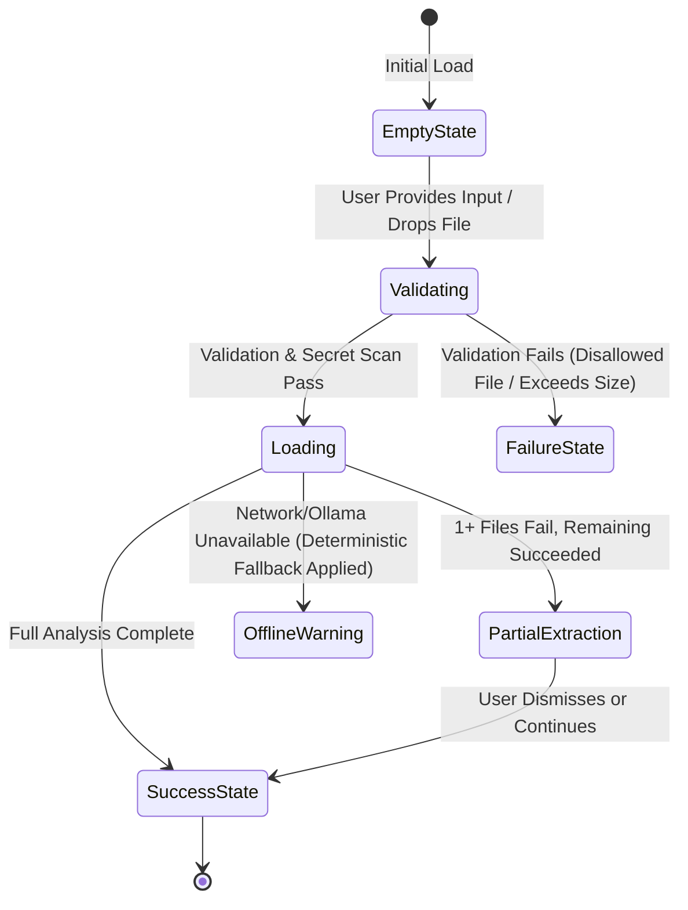

# DevRelief — User Experience & Interface Specification

**Product:** DevRelief  
**Document:** Responsive UI/UX Specification  
**Status:** Milestone 0 (Specification & Design Blueprint)  
**Target Standards:** WCAG 2.2 AA Compliance  

---

## 1. UX Philosophy & Core Paradigms

DevRelief is built around four fundamental interaction principles:

1. **A Workbench, Not a Conversational Bot:** Software delivery professionals require structured, dense, high-utility screens with actionable tables, diff viewers, and editable cards—not a conversational chat stream that disappears off-screen.
2. **Transparent Evidence & Epistemic Honesty:** The user must immediately see *where* each fact came from. Results present clear badges: `CONFIRMED FACT` (green), `INFERENCE` (amber), and `UNKNOWN` (slate).
3. **Frictionless Ingestion:** Drag-and-drop, clipboard paste, and direct multi-file selection are first-class interactions on both desktop and mobile.
4. **Adaptive Responsive Density:** The desktop layout exploits multi-column horizontal space with split evidence-and-result panes; the mobile view collapses into an ergonomic single-column vertical flow with bottom-sheet drawers.

---

## 2. Information Architecture & Navigation

The application navigation is organized into six core screens:

```
[Global Navigation]
  ├── Screen A: Home / Command Center (Overview, Role Selector, Quick Ingest)
  ├── Screen B: Ask DevRelief Workspace (Multimodal Ingestion & Cross-Artifact Query)
  ├── Screen C: Workflow Catalogue (5 Roles, Search, Categorized Workflows)
  ├── Screen D: Workflow Workspace (Guided Execution, Form, Validation, Output)
  ├── Screen E: History & Drafts (Saved Runs, Audit Trail, Export)
  └── Screen F: Settings & Privacy (Provider Toggles, Local Storage, Sanitization)
```

### Desktop Navigation Paradigm
- **Left Sidebar (240px fixed, collapsible to 64px icon bar):**
  - Brand header (`DevRelief` with status indicator `LOCAL DETERMINISTIC` or `OLLAMA ACTIVE`).
  - Active Role Selector dropdown (Developer, Product Owner, Scrum Master, QA, Engineering Manager).
  - Primary links: Home, Ask DevRelief, Workflows, History, Settings.
  - Storage & Privacy status badge at the bottom.
- **Main View Area:** Fluid container (`max-w-7xl` or full-width multi-pane for comparison views).

### Mobile Navigation Paradigm (<768px)
- **Top App Bar (56px fixed):**
  - Brand icon + Active Screen Title + Role indicator badge.
  - Privacy status chip.
- **Bottom Navigation Bar (64px fixed, with safe-area padding):**
  - 5 primary touch destinations: Home, Ask, Workflows, History, Settings.
  - Active destination indicated by distinct indicator pill and accessible `aria-current="page"`.
  - Minimum touch target: `48px x 48px`.

---

## 3. Screen-by-Screen Functional Blueprints

### Screen A: Home / Command Center

**Purpose:** Rapid role-based jumpstart, recent deliverable access, and instant task initiation.

#### Layout & Components
1. **Welcome & Active Role Header:**
   - Displays user's selected role with quick-switch tabs: `[All] [Developer] [Product Owner] [Scrum Master] [QA] [Engineering Manager]`.
2. **Primary Quick-Ask Bar:**
   - Prominent search-and-prompt input with placeholder: *"Ask DevRelief a question, paste a log, or drop files here..."*
   - Direct action buttons: `[Attach Files]`, `[Paste Clipboard]`, `[Run]`.
3. **Role-Tailored Recommended Workflows Grid:**
   - 3–4 high-impact workflows matching the active role (e.g. for Developer: *Git Daily Digest*, *CI Failure Triage*, *Release Note Generator*).
   - Each card displays input requirements, estimated run time, and deterministic guarantee badge.
4. **Recent Deliverables & Saved Drafts Panel:**
   - Table showing recent workflow executions with timestamp, role, inputs used, status (`Complete`, `Draft`), and action buttons (`Open`, `Export`, `Duplicate`).
5. **System Health & Privacy Strip:**
   - Status chips: `Provider: Local Deterministic (No Cloud AI)`, `Local Storage: 4.2 MB used`, `Secret Redaction: ON`.

---

### Screen B: Ask DevRelief Workspace

**Purpose:** Multimodal analysis canvas where users combine text instructions with one or multiple files (logs, screenshots, code diffs, specs).

#### Desktop Layout (Split-Pane Workbench)
- **Left Pane (45% width): Input & Evidence Staging Area**
  - **Prompt Area:** Expanding multi-line text area supporting Markdown syntax and `@attachment` mentions.
  - **Universal Dropzone:** High-contrast dotted perimeter. Supports drag-and-drop of multiple files or paste (`Ctrl+V` / `Cmd+V`).
  - **Attachment Staging Tray:**
    - List of attached files with thumbnail (for images), file type icon, filename, file size, validation badge (`Validated`, `Extracting`, `Secret Scanned`), and `[Remove]` button.
    - Secret Detection Banner: Alerts user if an API token or password was detected and redacted prior to processing.
  - **Action Toolbar:**
    - Engine selector: `Local Deterministic (Strict)` vs `Ollama Local (gemma2/llama3)`.
    - `[Clear All]` secondary button.
    - `[Analyze Evidence]` primary call-to-action button with keyboard shortcut tooltip (`Cmd+Enter`).

- **Right Pane (55% width): Structured Output & Evidence Inspector**
  - **Tabbed Results Header:** `[Structured Answer]`, `[Evidence Matrix]`, `[Raw Output]`.
  - **Executive Summary Card:** Direct, concise answer with status indicator.
  - **Findings by Category:**
    - Accordion items categorized by issue, root cause, and recommendations.
    - Each item carries an epistemic badge:
      - 🟢 `CONFIRMED FACT` (backed by direct log line or text extraction)
      - 🟡 `INFERENCE` (derived from pattern matching or model synthesis)
      - ⚪ `UNKNOWN` (missing data explicitly called out)
  - **Interactive Provenance Drawer:**
    - Clicking any citation (e.g. `[build.log:1482]`) opens the exact log excerpt with syntax highlighting and surrounding 5 lines of context.
  - **Export Toolbar:** `[Copy Markdown]`, `[Export JSON]`, `[Download Summary]`, `[Save to History]`.

#### Mobile Layout (<768px)
- Single-column stepped sequence:
  1. Prompt textarea with floating attachment button (camera icon for photo capture, document icon for files).
  2. Horizontal scrolling chip list of attachments with tap-to-remove.
  3. Full-width sticky bottom action bar with `[Analyze Evidence]` button.
  4. Tabbed results presented vertically; clicking citations opens a bottom-sheet modal drawer instead of a side pane.

---

### Screen C: Workflow Catalogue

**Purpose:** Comprehensive directory of all deterministic and AI-assisted workflows across all five roles.

#### Layout & Controls
1. **Search & Filter Bar:**
   - Instant live search by keyword (e.g. "Git", "Gherkin", "Jenkins", "Action Items").
   - Multi-select role pills: `Developer`, `Product Owner`, `Scrum Master`, `QA`, `Engineering Manager`.
   - Feature flags: `Deterministic Only (No AI)`, `Supports Image Ingestion`, `Requires Git Repo`.
2. **Workflow Cards Grid (Responsive: 1 col on mobile, 2 col on tablet, 3 col on desktop):**
   - **Card Anatomy:**
     - Header: Workflow icon, title, role category tag.
     - Description: 2-sentence plain-language summary of what the workflow does.
     - Required Inputs: Badge chips (e.g. `Git Log`, `Diff`, `Image`, `Plaintext`).
     - Engine Type: `Deterministic Core` or `AI Enhanced`.
     - Output Preview: Expandable sample output preview modal.
     - Footer: `[Launch Workflow]` primary button.

---

### Screen D: Workflow Workspace

**Purpose:** Guided, step-by-step execution form for a specific selected workflow.

#### Structure
1. **Header & Context:**
   - Breadcrumb navigation: `Workflows > Developer > Git Activity Daily Digest`.
   - Workflow description and expected deliverable explanation.
2. **Guided Step-by-Step Form:**
   - Step 1: Input Supply (Direct text input, file upload, or CLI paste).
   - Step 2: Configuration Parameters (e.g. Time window: "Last 24 Hours", Commit filter: "Exclude merge commits").
   - Step 3: Validation & Secret Scan Check.
3. **Execution State Indicator:**
   - Real-time step progress tracker: `Validating Files` ➔ `Sanitizing Secrets` ➔ `Parsing Commits` ➔ `Synthesizing Report`.
4. **Editable Output Canvas:**
   - Direct inline Markdown editor permitting users to refine, reword, or add manual notes before exporting.
   - Quick export actions: `[Copy to Clipboard]`, `[Download .MD]`, `[Export to Jira/Linear format]`.

---

### Screen E: History & Saved Drafts

**Purpose:** Searchable archive of past runs, generated deliverables, and active working drafts.

#### Features
- **Local-First Storage:** Stored exclusively in browser IndexedDB / local storage by default.
- **Data Table:**
  - Columns: Timestamp, Workflow Name, Target Role, Input Summary, Engine Used, Actions (`View`, `Re-run`, `Delete`).
- **Batch Management:** Multi-select rows to bulk-delete or export an archive JSON.
- **Zero Cloud Sync Notice:** Prominent notice confirming records remain local on this machine.

---

### Screen F: Settings & Privacy Center

**Purpose:** Absolute user control over data boundaries, processing locations, models, and limits.

#### Settings Sections
1. **AI Processing Provider:**
   - Radio options:
     - `Deterministic Only (No AI, Maximum Privacy & Speed)`
     - `Local Ollama Runtime (Host: http://localhost:11434, Models: gemma2, llama3, qwen2.5)`
     - `Cloud API (Optional, disabled by default, requires explicit API key injection)`
   - Provider Health Check: Real-time latency and connectivity ping button with error diagnostics.
2. **Multimodal Ingestion Limits:**
   - Max file size slider (Default: 20 MB; Maximum allowed: 50 MB).
   - Max attachments per query (Default: 5; Maximum: 10).
   - OCR Engine toggle: `Browser Tesseract WASM` vs `Server-side OCR`.
3. **Security & Redaction Settings:**
   - Automated Secret Redaction: Toggle (Default: ON).
   - Custom Regex Redaction Patterns: Configurable list for internal project identifiers.
4. **Local Data Management:**
   - Storage usage breakdown: IndexedDB items, cached attachments, history records.
   - Danger Zone: `[Clear All Local History & Storage]` with double-confirmation modal.

---

## 4. Universal Application States

Every screen and component explicitly implements seven standard states:



1. **Empty State:** Clean, instructive illustration with helpful placeholder suggestions and direct sample action buttons.
2. **Validating State:** Immediate visual feedback during file signature and secret scanning (<200ms).
3. **Loading State:** Non-blocking skeleton loaders with step-by-step progress labels (no spinning indeterminate loops).
4. **Success State:** Clear results card with epistemic tags and provenance links.
5. **Partial-Extraction State:** Amber alert banner specifying which attachment failed and why, with full results rendered from the successful attachments.
6. **Offline / Fallback State:** Slate status banner indicating AI is unavailable and deterministic rule-based output has been produced instead.
7. **Failure State:** Clear, human-readable error explanation with actionable remediation steps (e.g. *"File exceeds 50MB limit. Try attaching only the last 2,000 lines of the log."*).

---

## 5. Responsive Breakpoint & Mobile Ergonomics

| Breakpoint | Target Devices | Layout Behavior |
| :--- | :--- | :--- |
| **`sm` (<640px)** | Mobile Phones | 1-column layout, sticky bottom nav, 100% width inputs, bottom-sheet provenance modal. |
| **`md` (640px–1023px)** | Tablets & Small Laptops | Collapsible sidebar, 1 or 2-column cards, drawer-based evidence inspector. |
| **`lg` (1024px–1279px)** | Standard Laptops | 2-column split workbench (Staging left, Output right), persistent 240px sidebar. |
| **`xl` (>=1280px)** | Desktops & Monitors | High-density multi-pane workbench with simultaneous input, output, and citation viewer. |

### Mobile Touch & Keyboard Guidelines
- All interactive controls have a minimum bounding box of **44px x 44px**.
- Mobile keyboard appearance automatically shifts the primary `[Analyze]` action above the virtual keyboard without obscuring the text prompt.
- File picker allows direct photo capture (`capture="environment"` attribute on mobile file input for whiteboard/error screen capture).
- Zero horizontal scrolling on all primary workflows and tables (tables wrap or convert to card lists below `md`).

---

## 6. Accessibility (WCAG 2.2 AA) Directives

1. **Keyboard Operability:**
   - Global keyboard shortcuts: `Cmd/Ctrl + K` (Search/Command palette), `Cmd/Ctrl + Enter` (Submit query), `Esc` (Dismiss modal/drawer).
   - Logical tab indices across all forms and custom dropzones.
2. **Focus Visibility:**
   - Universal high-contrast focus ring: `outline: 2px solid var(--color-primary-600)` with `outline-offset: 2px`.
3. **Screen Reader Semantics:**
   - Semantic landmarks: `<header>`, `<nav>`, `<main>`, `<aside>`, `<footer>`.
   - ARIA live regions (`aria-live="polite"`) for file ingestion progress and result generation.
   - Provenance badges include explicit aria labels: `aria-label="Confirmed fact verified from build.log line 1482"`.
4. **Contrast Ratios:**
   - Body text: Minimum 4.5:1 contrast against background.
   - Large text & badges: Minimum 3.0:1 contrast.
   - Never rely solely on color to communicate state; all indicators combine color, icon, and text.
